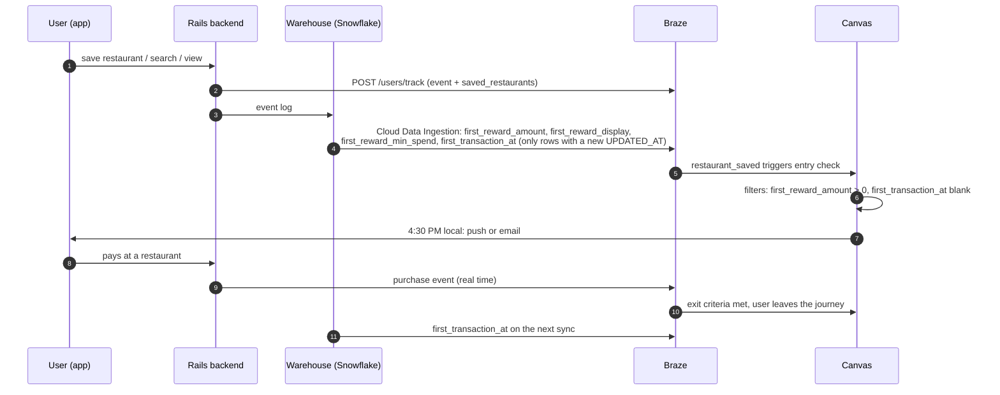

# 01 — Data Contract

The journey needs browse intent, the referral reward, and purchase state on the Braze profile. The app, the Rails backend, and the warehouse should already have all of it; the work is getting it across the wire with one owner per field.

---

## 1. What the journey needs

| Name | Type | Owner and path | Used for |
|---|---|---|---|
| `first_reward_amount` | Custom attribute (number) | Warehouse → Cloud Data Ingestion | Entry filter, abort |
| `first_reward_display` | Custom attribute (string, e.g. "25" or "12.50") | Warehouse → Cloud Data Ingestion | Message copy, so Liquid never formats currency |
| `first_reward_min_spend` | Custom attribute (number, e.g. 50) | Warehouse → Cloud Data Ingestion | Message copy: the minimum the reward needs |
| `first_transaction_at` | Custom attribute (time) | Warehouse → Cloud Data Ingestion | Entry filter (blank = never paid) |
| `saved_restaurants` | Custom attribute (array of restaurant IDs) | Rails backend → `/users/track` | Message personalization |
| `restaurants` | Catalog (`id`, `name`, `deep_link`, `neighborhood`) | Rails backend → Catalogs API | Restaurant names and links in the message |
| `restaurant_saved` | Custom event (`restaurant_id`, `cuisine`) | App SDK or Rails backend → `/users/track` | Entry trigger; exits the browsing Canvas |
| `restaurant_viewed` | Custom event (`restaurant_id`) | App SDK or Rails backend → `/users/track` | Intent signal |
| `search_performed` | Custom event (`area`) | App SDK or Rails backend → `/users/track` | Intent signal |
| Purchase | Purchase event | Rails backend → `/users/track` | Exit criteria, conversion |
| Push / email subscription state | Standard | SDK, preferences | Channel routing |
| Total sessions, First Used App | Collected by the Braze SDK | SDK | Entry filters for the browsing Canvas (02, section 4) |

`saved_restaurants` stores IDs because they stay stable when a restaurant changes its name; the message looks up the current name and deep link from the `restaurants` Catalog. The `restaurant_saved` event's `restaurant_id` reaches the message as Canvas context (`context.${restaurant_id}`), so the message names the restaurant that triggered entry and uses `saved_restaurants` as the fallback.

The referral reward is its own record, not a wallet balance. The app's terms say a Reward applies only when the food and beverage subtotal meets its minimum and the bill is paid in the app, and that it can't be combined with inKind Cash, Cash Back, or other wallet balances. So the journey reads the reward's amount and minimum directly.

Any other per-user value the messaging needs follows the same path as `first_reward_amount`: computed where the data lives, synced to the profile, read in Liquid.

---

## 2. How the data reaches Braze

Two paths, split by how fresh the data has to be:

- **Real time (`/users/track`):** events that trigger or exit the journey, where a delay would mean a late or wrong message.
- **Warehouse (Cloud Data Ingestion):** computed attributes that already live in Snowflake. Braze syncs only rows whose `UPDATED_AT` has changed since the last sync.



The purchase event goes through `/users/track` so the exit fires immediately; `first_transaction_at` catches up on the next warehouse sync.

---

## 3. Sample `/users/track` payloads

When a user saves a restaurant:

```json
{
  "attributes": [
    {
      "external_id": "u_123",
      "saved_restaurants": ["r_456", "r_789"]
    }
  ],
  "events": [
    {
      "external_id": "u_123",
      "name": "restaurant_saved",
      "time": "2026-10-24T18:02:00Z",
      "properties": { "restaurant_id": "r_456", "cuisine": "mexican" }
    }
  ]
}
```

On a purchase:

```json
{
  "purchases": [
    {
      "external_id": "u_123",
      "product_id": "dine_in",
      "currency": "USD",
      "price": 62.40,
      "time": "2026-10-25T19:41:00Z"
    }
  ]
}
```

If the first meal uses the reward, the backend marks it redeemed and the next warehouse sync clears the reward fields. The purchase exit doesn't wait for that sync.

---

## 4. Snowflake view for Cloud Data Ingestion

Braze reads a table or view with `EXTERNAL_ID`, `UPDATED_AT` (UTC), and a `PAYLOAD` JSON column in `/users/track` attribute format.

```sql
CREATE OR REPLACE VIEW braze_first_reward_attributes AS
SELECT
  r.user_id                         AS EXTERNAL_ID,
  GREATEST(r.updated_at, COALESCE(t.first_at, r.updated_at)) AS UPDATED_AT,
  OBJECT_CONSTRUCT_KEEP_NULL(
    'first_reward_amount',    IFF(r.redeemed_at IS NULL, r.amount, NULL),
    'first_reward_display',   IFF(r.redeemed_at IS NULL,
                                  IFF(r.amount = FLOOR(r.amount),
                                      TO_VARCHAR(r.amount::INT),
                                      TRIM(TO_VARCHAR(r.amount, '9999990.00'))),
                                  NULL),
    'first_reward_min_spend', IFF(r.redeemed_at IS NULL, r.min_spend::INT, NULL),
    'first_transaction_at',   t.first_at
  )                                 AS PAYLOAD
FROM rewards r
LEFT JOIN (
  SELECT user_id, MIN(created_at) AS first_at
  FROM transactions
  GROUP BY user_id
) t
  ON t.user_id = r.user_id
WHERE r.reward_type = 'referral_welcome';
```

`OBJECT_CONSTRUCT_KEEP_NULL` sends nulls on purpose. When a reward is redeemed, its three fields go to null and Braze removes them from the profile; plain `OBJECT_CONSTRUCT` would drop those keys, and the profile would keep showing $25 after it was spent. A user with no transactions gets a null `first_transaction_at`, which the entry filter reads as blank. `first_reward_display` drops the decimals for whole-dollar amounts ("25") and keeps two otherwise ("12.50"), so the message never shows "$25.0". The view assumes one welcome reward per user and that redeeming it updates `rewards.updated_at`.

In production, `UPDATED_AT` should come from when the row was loaded or changed, not when the transaction happened, so late-arriving data still syncs. The view above derives it from event times for readability.

---

## 5. Sync rules

| Rule | Why |
|---|---|
| One owner per field: either the warehouse or the backend writes it, never both | Two writers race, and the profile ends up with whichever arrived last |
| Send attributes only when they change (`UPDATED_AT` for the warehouse, change detection for the backend) | Avoids wasted data points and keeps the profile accurate |
| Batch `/users/track` up to Braze's per-request object limit (75) | Throughput without hitting rate limits |
| Backend records each event ID it has sent | Braze doesn't dedupe custom events or purchases, so a retried job would double-count a save or a purchase unless the backend prevents it |
| Reconcile nightly against the warehouse | Catches users whose events silently failed to sync |
