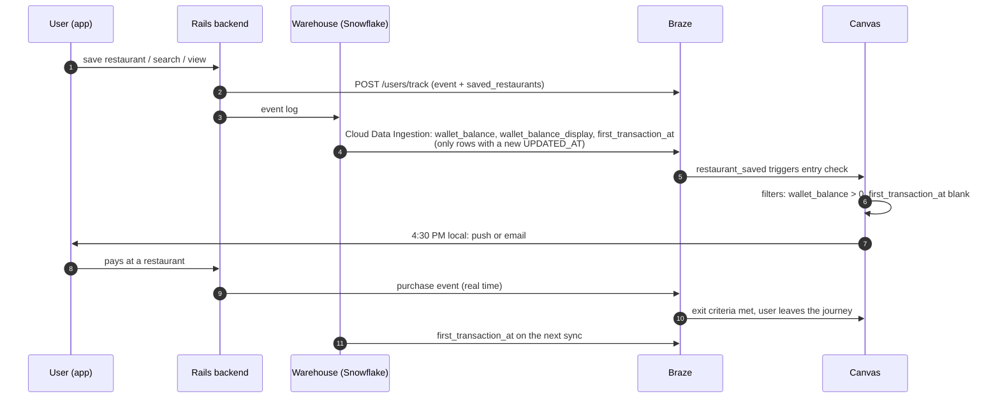

# 01 — Data Contract

The journey needs browse intent, credit, and purchase state on the Braze profile. The app, the Rails backend, and the warehouse should already have all of it; the work is getting it across the wire with one owner per field.

---

## 1. What the journey needs

| Name | Type | Owner and path | Used for |
|---|---|---|---|
| `wallet_balance` | Custom attribute (number) | Warehouse → Cloud Data Ingestion | Entry filter, abort |
| `wallet_balance_display` | Custom attribute (string, e.g. "25" or "12.50") | Warehouse → Cloud Data Ingestion | Message copy, so Liquid never formats currency |
| `first_transaction_at` | Custom attribute (time) | Warehouse → Cloud Data Ingestion | Entry filter (blank = never paid) |
| `saved_restaurants` | Custom attribute (array of restaurant IDs) | Rails backend → `/users/track` | Message personalization |
| `restaurants` | Catalog (`id`, `name`, `deep_link`, `neighborhood`) | Rails backend → Catalogs API | Restaurant names and links in the message |
| `restaurant_saved` | Custom event (`restaurant_id`, `cuisine`) | App SDK or Rails backend → `/users/track` | Entry trigger |
| `restaurant_viewed` | Custom event (`restaurant_id`) | App SDK or Rails backend → `/users/track` | Intent signal |
| `search_performed` | Custom event (`area`) | App SDK or Rails backend → `/users/track` | Intent signal |
| Purchase | Purchase event | Rails backend → `/users/track` | Exit criteria, conversion |
| Push / email subscription state | Standard | SDK, preferences | Channel routing |

`saved_restaurants` stores IDs because they stay stable when a restaurant changes its name; the message looks up the current name and deep link from the `restaurants` Catalog.

Any other per-user value the messaging needs, such as an offer amount or threshold, follows the same path as `wallet_balance`: computed where the data lives, synced to the profile, read in Liquid.

---

## 2. How the data reaches Braze

Two paths, split by how fresh the data has to be:

- **Real time (`/users/track`):** events that trigger or exit the journey, where a delay would mean a late or wrong message.
- **Warehouse (Cloud Data Ingestion):** computed attributes that already live in Snowflake. Braze syncs only rows whose `UPDATED_AT` has changed since the last sync.



The purchase event goes through `/users/track` so the exit fires immediately; `first_transaction_at` catches up on the next warehouse sync.

---

## 3. Sample `/users/track` payloads

When a user saves a restaurant:

```json
{
  "attributes": [
    {
      "external_id": "u_123",
      "saved_restaurants": ["r_456", "r_789"]
    }
  ],
  "events": [
    {
      "external_id": "u_123",
      "name": "restaurant_saved",
      "time": "2026-10-24T18:02:00Z",
      "properties": { "restaurant_id": "r_456", "cuisine": "mexican" }
    }
  ]
}
```

On a purchase:

```json
{
  "purchases": [
    {
      "external_id": "u_123",
      "product_id": "dine_in",
      "currency": "USD",
      "price": 62.40,
      "time": "2026-10-25T19:41:00Z"
    }
  ]
}
```

How the wallet changes when someone pays (credit spent, cash back earned) is one of the things I'd confirm; the warehouse sync would carry the new balance either way.

---

## 4. Snowflake view for Cloud Data Ingestion

Braze reads a table or view with `EXTERNAL_ID`, `UPDATED_AT` (UTC), and a `PAYLOAD` JSON column in `/users/track` attribute format.

```sql
CREATE OR REPLACE VIEW braze_first_credit_attributes AS
SELECT
  u.user_id                         AS EXTERNAL_ID,
  GREATEST(w.updated_at, COALESCE(t.first_at, w.updated_at)) AS UPDATED_AT,
  OBJECT_CONSTRUCT(
    'wallet_balance',         w.balance,
    'wallet_balance_display', IFF(w.balance = FLOOR(w.balance),
                                  TO_VARCHAR(w.balance::INT),
                                  TRIM(TO_VARCHAR(w.balance, '9999990.00'))),
    'first_transaction_at',   t.first_at
  )                                 AS PAYLOAD
FROM users u
JOIN wallets w
  ON w.user_id = u.user_id
LEFT JOIN (
  SELECT user_id, MIN(created_at) AS first_at
  FROM transactions
  GROUP BY user_id
) t
  ON t.user_id = u.user_id;
```

`OBJECT_CONSTRUCT` leaves out null values, so a user with no transactions gets no `first_transaction_at`, which is what the entry filter expects. `wallet_balance_display` drops the decimals for whole-dollar balances ("25") and keeps two otherwise ("12.50"), so the message never shows "$25.0".

---

## 5. Sync rules

| Rule | Why |
|---|---|
| One owner per field: either the warehouse or the backend writes it, never both | Two writers race, and the profile ends up with whichever arrived last |
| Send attributes only when they change (`UPDATED_AT` for the warehouse, change detection for the backend) | Avoids wasted data points and keeps the profile accurate |
| Batch `/users/track` up to Braze's per-request object limit (75) | Throughput without hitting rate limits |
| Idempotent sends keyed on event ID | A retried request can't double-count a save or a purchase |
| Reconcile nightly against the warehouse | Catches users whose events silently failed to sync |
