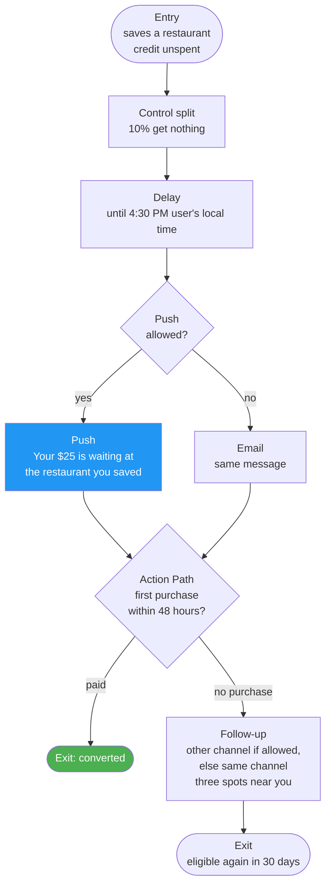

# 02 — Audience and Journey

Users enter when they show intent but have never paid and still have credit to spend. Any purchase ends the journey.

---

## 1. Audience

| Rule | Setting |
|---|---|
| Entry trigger | Performs `restaurant_saved` |
| Filters | `wallet_balance` > 0 AND `first_transaction_at` is blank AND (push opted in OR email subscribed) |
| Re-entry | Once every 30 days at most |
| Control group | 10% held out to measure lift |
| Exit criteria | Makes any purchase |

### The same audience in the warehouse

Used to spot-check Braze's audience count before launch.

```sql
SELECT u.user_id
FROM users u
JOIN wallets w        ON w.user_id = u.user_id
LEFT JOIN transactions t ON t.user_id = u.user_id
LEFT JOIN app_events e
       ON e.user_id = u.user_id
      AND e.event_at >= DATEADD(day, -14, CURRENT_DATE)
WHERE w.balance > 0
  AND t.user_id IS NULL
GROUP BY u.user_id
HAVING COUNT_IF(e.event_name = 'restaurant_saved') >= 1;
```

This counts everyone eligible. Braze also requires push or email permission, so its count will be lower; the difference is users with no reachable channel.

---

## 2. The Canvas



Push carries the first nudge when it's allowed, email when it isn't, and one follow-up catches anyone who doesn't buy within 48 hours. The follow-up goes on the other channel when the user has one, and on the same channel otherwise. The Canvas exit criteria remove anyone who purchases at any step.

---

## 3. Why these choices

| Choice | Reason |
|---|---|
| Trigger on a save, not a schedule | A save is the strongest intent signal a non-buyer gives |
| Saves only, for now | Repeat sessions without a save could be a second entry path, computed as `sessions_14d` in the warehouse and synced like `wallet_balance` |
| 4:30 PM local | Lands while people decide where to eat; test against Intelligent Timing |
| Push first | Timely, short, and links straight into the app |
| One follow-up, then stop | Two touches over about two days is enough for a new user; more risks opt-outs |
| 10% control | Proves the journey caused the purchases, not the referral itself |
