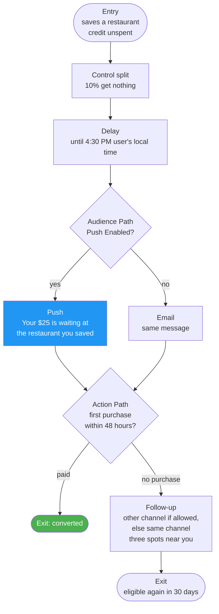

# 02 — Audience and Journey

Users enter when they show intent but have never paid and still have credit to spend. The main Canvas triggers on a save; a smaller second Canvas catches new users who keep opening the app without saving. Any purchase ends either one.

---

## 1. Audience

| Rule | Setting |
|---|---|
| Entry trigger | Performs `restaurant_saved` |
| Filters | `wallet_balance` > 0 AND `first_transaction_at` is blank |
| Send settings | Subscribed or opted-in, per channel |
| Conversion event | Makes Purchase within 7 days |
| Re-entry | Once every 30 days at most |
| Control group | 10% held out to measure lift; a re-entering user stays in the same group |
| Exit criteria | Makes any purchase |

### The same audience in the warehouse

Used to spot-check Braze's audience count before launch.

```sql
SELECT u.user_id
FROM users u
JOIN wallets w           ON w.user_id = u.user_id
LEFT JOIN transactions t ON t.user_id = u.user_id
WHERE w.balance > 0
  AND t.user_id IS NULL;
```

This counts everyone who matches the entry filters. The save is the trigger, so it isn't in this count. Braze only counts users its Send Settings can reach on push or email, so its count will be lower; the difference is users with no reachable channel.

---

## 2. The Canvas



Push carries the first nudge when push is enabled, email when it isn't, and one follow-up catches anyone who doesn't buy within 48 hours. The follow-up goes on the other channel when the user has one, and on the same channel otherwise. The Canvas exit criteria remove anyone who purchases at any step.

---

## 3. Why these choices

| Choice | Reason |
|---|---|
| Trigger on a save, not a schedule | A save is the strongest intent signal a non-buyer gives |
| 4:30 PM local | Lands while people decide where to eat; test against Intelligent Timing |
| Push first | Timely, short, and links straight into the app |
| Send Settings: subscribed or opted-in | This is an onboarding nudge to someone who just acted, not a broad promotion; consent lives in one place instead of in the entry filters |
| Rule-based channel split, not Intelligent Channel | Intelligent Channel needs 3+ messages across 2+ channels, and a new user doesn't have that history yet |
| One follow-up, then stop | Two touches over about two days is enough for a new user; more risks opt-outs |
| 10% control | Proves the journey caused the purchases, not the referral itself |

---

## 4. Second entry: browsing without a save

A new user who opens the app three times in their first two weeks but never saves a restaurant is showing intent too. They get their own small Canvas rather than a second trigger on the main one: entry filters apply to every trigger in a Canvas, so a session-count filter there would also block savers, and checking it after entry would use up a user's 30-day re-entry on their first session.

| Rule | Setting |
|---|---|
| Entry trigger | Starts a session |
| Filters | `wallet_balance` > 0 AND `first_transaction_at` is blank AND total sessions ≥ 3 AND First Used App less than 14 days ago AND `saved_restaurants` is empty |
| Send settings | Subscribed or opted-in, per channel |
| Conversion event | Makes Purchase within 7 days |
| Re-entry | Once |
| Control group | 10%, as in the main Canvas |
| Exit criteria | Makes any purchase, or performs `restaurant_saved` (the main Canvas takes over) |

The flow is the main Canvas without the saved-restaurant branch: delay to 4:30 PM local, push if enabled, otherwise email, one follow-up after 48 hours. The same template sends the nearby-picks copy, because these users have no saved restaurant. Users who don't meet the filters never enter, so nothing counts against their re-entry until their third session.
