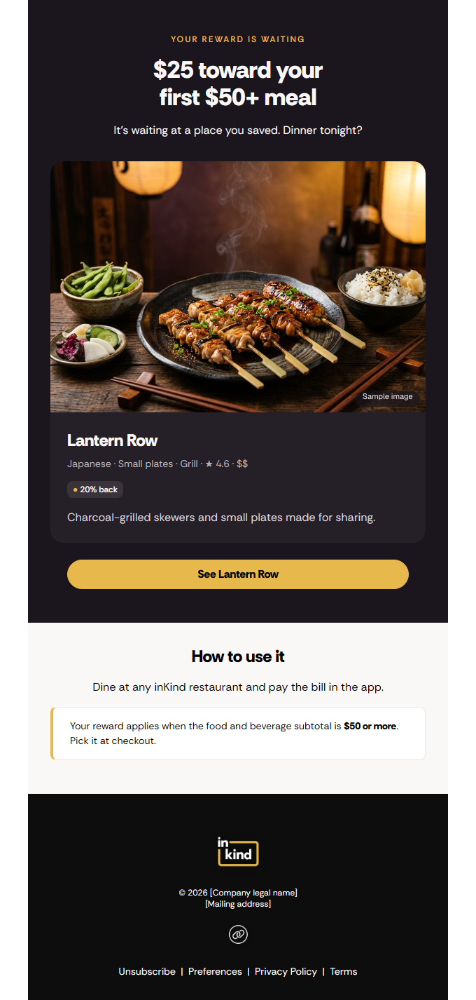
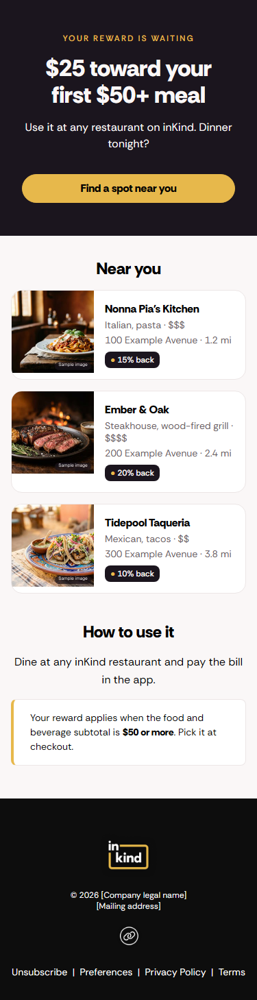

# liquid/: the first-reward message as Content Blocks

[`03-message.liquid`](../03-message.liquid) is one message in one file. This folder is how I'd structure it once there are twenty messages: each piece is a Braze Content Block, so a message assembles blocks instead of repeating them, and one change to `ik_brand` restyles every email.

This is my sketch, not inKind's template or an email inKind sent. The colors, logo, and icons come from inKind's emails. The restaurants, their photos, and the footer's legal name and address are made up.



---

## Layers

Each file in `blocks/` is one Content Block, named after the file. A message includes one with `{{content_blocks.${name}}}`.

| Layer | Blocks | Job |
|---|---|---|
| config | `ik_brand`, `ik_urls` | Design tokens (color, type, spacing, widths), logo and icon paths, legal footer, base and social URLs |
| logic | `ik_get_reward`, `ik_get_saved_restaurant`, `ik_get_nearby`, `ik_restaurant_link` | Read data and decide. Print nothing. Shared by push and email |
| layout | `ik_layout_open`, `ik_layout_close` | Document shell, preheader, mobile CSS |
| elements | `ik_button`, `ik_badge_cashback` | Smallest visible pieces. The button carries Outlook's VML version |
| components | `ik_card_restaurant_feature`, `ik_card_restaurant_compact`, `ik_card_restaurant_row`, `ik_callout`, `ik_how_to_use_reward` | Cards and notes built from elements |
| sections | `ik_hero_text`, `ik_section_restaurant_list`, `ik_footer` | Full-width bands a message stacks |

Logic blocks never print, and visible blocks never look anything up. That's what lets [`messages/first_reward.push.liquid`](messages/first_reward.push.liquid) reuse the email's logic unchanged.

Variants are inputs, not copies. There's one button with a `btn_style` input, one list with a `list_style` input, and one callout with a `callout_style` input, so a new style is a few lines in one block rather than a new block for every color.

## Tokens

Every color, font size, spacing value, and width a block uses comes from `ik_brand`. Tests fail if a block hard-codes a hex color or a pixel value for padding, margin, or font size.

| Family | Tokens |
|---|---|
| Color | `ik_color_dark`, `_light`, `_white`, `_black`, `_card_dark`, `_chip_dark`, `_gold`, `_on_gold`, `_ink`, `_muted`, `_muted_dark`, `_body_dark`, `_border` |
| Type, px | `ik_text_xs` 12, `_sm` 14, `_md` 16, `_lg` 19, `_xl` 24, `_display` 34 |
| Spacing, px | `ik_space_xxs` 4, `_xs` 8, `_sm` 16, `_md` 24, `_lg` 32, `_xl` 48 |
| Width, px | `ik_width` 600; `ik_content_width` and `ik_button_width` are derived from it; `ik_thumb` 120 |

The gallery opens with a token sheet rendered from `ik_brand` itself, so it can't drift from the values.

## Naming

- Every block starts with `ik_`, and its folder is its layer
- A block's inputs share a prefix with it: `btn_` for the button, `hero_` for the hero, `list_` for the list, `callout_` for the callout
- Each header comment has the same three lines: `Inputs:`, `Outputs:`, and optional `Notes:`. A test checks the first two

## Inputs and outputs

Liquid variables are global, so a block's inputs are variables set just before it's included. Each block's header comment lists its own.

| Block | Reads | Sets |
|---|---|---|
| `ik_get_reward` | `first_reward_amount`, `first_reward_display`, `first_reward_min_spend` | `reward`, `reward_display`, `min_spend`, `offer`, `reward_ok`, `reward_skip_reason` |
| `ik_get_saved_restaurant` | `context.${restaurant_id}`, `saved_restaurants`, `restaurants` Catalog | `saved`, `saved_name` |
| `ik_get_nearby` | user ID, recommendations endpoint (placeholder) | `nearby`, or nothing if the call fails |
| `ik_restaurant_link` | `card` | `card_link` |
| `ik_layout_open` | `page_title`, `preheader` | |
| `ik_button` | `btn_label`, `btn_url`, optional `btn_style` (`primary` or `dark`) | |
| `ik_badge_cashback` | `card`, optional `badge_bg` | |
| `ik_card_restaurant_feature`, `ik_card_restaurant_compact`, `ik_card_restaurant_row` | `card` | |
| `ik_callout` | `callout_text`, optional `callout_style` (`note` or `dark`) | |
| `ik_how_to_use_reward` | `min_spend` | |
| `ik_hero_text` | `hero_eyebrow`, `hero_headline`, `hero_body`, optional `hero_card`, `btn_label`, `btn_url`, `btn_style` | |
| `ik_section_restaurant_list` | `list_title`, `list_items`, optional `list_limit` (default 3), optional `list_style` (`card` or `row`) | |

## Why the abort lives in the message

`ik_get_reward` only sets `reward_ok` and a reason. Each message checks it and calls `abort_message` itself, before any Catalog or Connected Content lookup. The stop stays visible in the message, and it doesn't depend on how Braze treats an abort inside a Content Block.

## Messages

| Case | Email | Push |
|---|---|---|
| Saved restaurant found in the Catalog | Feature card, "See Lantern Row" | "…is waiting at Lantern Row. Dinner tonight?" |
| Nothing saved, or ID not in the Catalog | "Near you" list of three image-left rows | "…Nearby: Nonna Pia's Kitchen, Ember & Oak, Tidepool Taqueria" |
| Recommendations call fails | Explore button only | "…Find a spot near you tonight." |
| No unused reward, zero amount, or no minimum | Abort | Abort |

Every email also ends with "How to use it", where a callout states the $50 minimum, and a footer with Unsubscribe, Preferences, Privacy Policy, and Terms.



## Source and built files

`blocks/` and `messages/` are the source: what you edit, and what would go into Braze as Content Blocks. `previews/` is built from them by `tests/build_previews.py` with the test fixtures, so nobody edits a preview by hand; change a block and rebuild. The blocks are already inline-styled, so the build only renders Liquid. There's no CSS-inlining step.

Every case is in [`previews/index.html`](previews/index.html). [`previews/component-gallery.html`](previews/component-gallery.html) shows the token sheet, then every visible block rendered alone by layer, with each variant side by side. GitHub shows HTML as source, so download them or open them locally.

The logo and footer icons are in [`images/`](images/), taken from inKind's emails. The blocks point at them with relative paths so the previews render offline; in Braze, each path becomes the image's media library URL. Social icons appear only when their profile URLs are set in `ik_urls`.

## Tests

```sh
pip install -r liquid/requirements.txt
python -m pytest liquid/tests -v
```

[`tests/harness.py`](tests/harness.py) stands in for Braze: it inlines Content Blocks by name and replaces Braze-only syntax (`catalog_items`, `connected_content`, `abort_message`, `custom_attribute`, `context`, the unsubscribe and preference center tags) with fixture data. [`tests/fixtures.py`](tests/fixtures.py) holds ten cases: the seven Liquid previews from [`04`](../04-qa-and-measurement.md), plus a $12.50 reward, three long restaurant names, and a zero amount. The restaurants are fictional, with `demo-` location IDs so a link can't open a real listing, and their photos are AI-generated sample images in `images/samples/`, each labeled "Sample image": a full-width JPEG for cards and a square one for row thumbnails. A test fails if any email loads an image from outside `images/`.

| File | Checks |
|---|---|
| `test_messages.py` | Each case's email and push: the right restaurant and links, escaped names, nearby picks as rows, both channels abort, push stays under `PUSH_MAX`, and every email has the unsubscribe, preferences, privacy, and terms links, the legal address, the preheader, the minimum callout, and the Outlook button |
| `test_parity.py` | The library's push matches `03-message.liquid` exactly in every case, abort reasons included |
| `test_blocks.py` | Every block states its inputs and outputs and renders alone; no block hard-codes a color, spacing, or font size; each variant (button, callout, list) renders its own style; cards work with and without a photo; every image has alt text; footer images exist and social icons need a URL; the color scheme is light only; a different `ik_brand` restyles colors, spacing, and type across the gallery; `reward_ok` is set correctly |

They run on every push that touches this folder or `03` ([`.github/workflows/liquid-tests.yml`](../.github/workflows/liquid-tests.yml)).

To rebuild the previews, run `python liquid/tests/build_previews.py`. Add `--screenshots` for PNGs at 680px and 375px wide, which needs `pip install playwright && playwright install chromium`.

## How I'd deploy it

- Create and update each block through Braze's Content Blocks REST API from CI after the tests pass, so a block change is reviewed like code
- Keep UTM parameters in Braze Link Templates rather than in the blocks
- Build the blocks in a dev workspace first, and preview each message case there before anything sends, as in [`04`](../04-qa-and-measurement.md)

Block, Catalog, and field names are illustrative, to be mapped to inKind's schema.
